# 记录一次失败的玩具项目心得

## 技术栈

codex + deepseek 4.0/4.1 flash
ts + nodejs + mysql

## 项目概览

这次的玩具项目规模比较大, 属于重agent项目, 是一个文字RPG类游戏, 但和传统的RPG不同的是, 里面的很多内容都是由ai即时演算的

比如 世界AI导演, 负责统一编排世界剧情的演化, 不再是固定的剧情
ai npc, 拥有独立的记忆(设定+事实+对话上下文), 会根据不同情景做出选择, 和玩家对话也会更加多变
ai 旁白, 即时描绘场景
ai 动作识别, 用户输入一句话, ai将其识别为系统支持的动作
ai 提案, 系统裁决, 保证系统运行的可靠性 

## 项目过程

### 想法

一开始, 只是有一个模糊的想搞一个ai参与度高的, 不一样的项目, 由于本人玩游戏比较多, 但是大多数游戏剧情比较固定, 所以就想搞出一个ai演化的PG游戏,

但是呢, 由于我的主要目的是开发ai演化, 所以就把游戏的其它内容直接忽略, 比如画面

### 开始与结束

由于只是一个模糊的想法, 所以我先找ai一起讨论出了项目的需求规格, 然后让ai按照需求文档拆分开发计划, 再就是进行开发, 最后是我进行试玩

讨论需求规格的时候, 感觉ai还是很靠谱的, 提出了许多建议和想法, 以至于我都认为整个项目会比较顺利的完成,

这里说一下为什么直接拆开发计划, 而不是细化文档, 比如说给出系统架构图, 模块设计文档, 然后是开发计划

我这么做主要是基于过去的经验, 以及还是对ai掌握的不够

1. 之前使用github copilot时候, 用的是claude 4.5, 文档我让ai写, 然后自己审核, 但是发现文档写的多没有屌用, ai还是有概率遗忘, 
高级模型大概率还能理解你的指正, 低级模型直接开始瞎几把改

2. 文档和代码有什么区别? 在有ai的情况下, 有必要把所有细节都描绘出来吗, 和用代码实现有什么区别, 如果文档非常详细, 那么后面进行迭代的时候,
就意味着你需要同时更新两份资源, 一旦迭代过多, 会变得非常麻烦

3. 所以我这次想的是只给需求规格, 然后让ai自行发挥, 搞出一个能跑的项目, 后面再进行优化

这么做的结果是, 确实搞出来一个能跑的文字游戏世界, 也能够进行世界ai演化, npc也能回答一些问题, **但是**, 试玩的时候就会发现有很多东西不对劲

比如世界剧情推进, 旁白老是重复一些描述, npc插话, npc胡说八道, 玩家可以进行注入(直接升级), 没有场景限制, 动作识别不准, 不好调试等等一系列的问题

然后呢, 我就如愿以偿的开始各种优化, 最后的结果是人麻了

### 游戏截图

初始化

@图1

进入世界

@图2

发生对话

@图3

调试日志

@图4

总体来说, 总算是能玩了, 但也仅限于初期, 游戏再往后发展, 我也没试过, 感觉会有很多问题, 不过主要的目标达到了

> 本来还说想搞一个语音识别+语音朗读, 再加上音乐, 结果改问题改的人麻了

## 架构与设计

一开始没有设计, 都是开发完毕后补充的, 方便以后翻阅

### 系统架构图

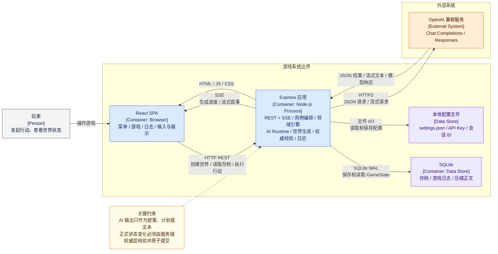

### 模块设计图

express 应用内部模块设计图

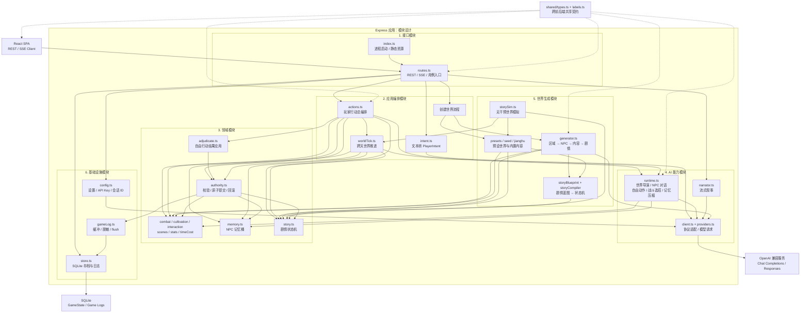

双向依赖问题

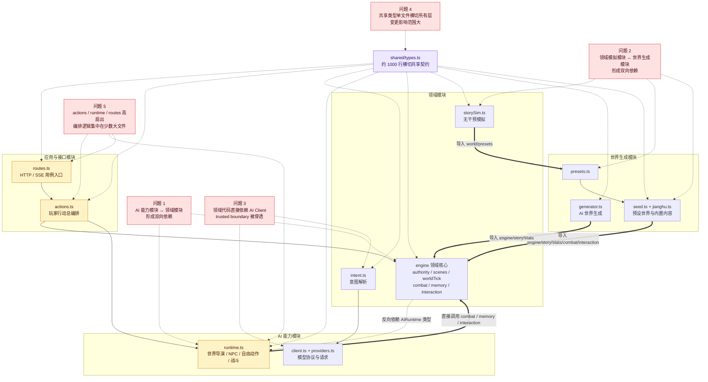

理想依赖优化

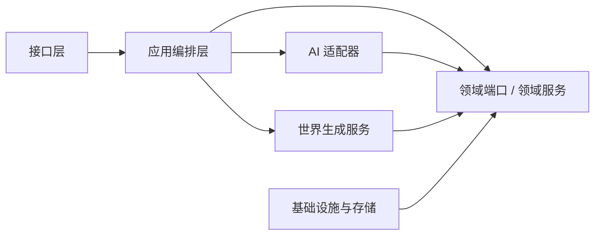

### 玩家时序图

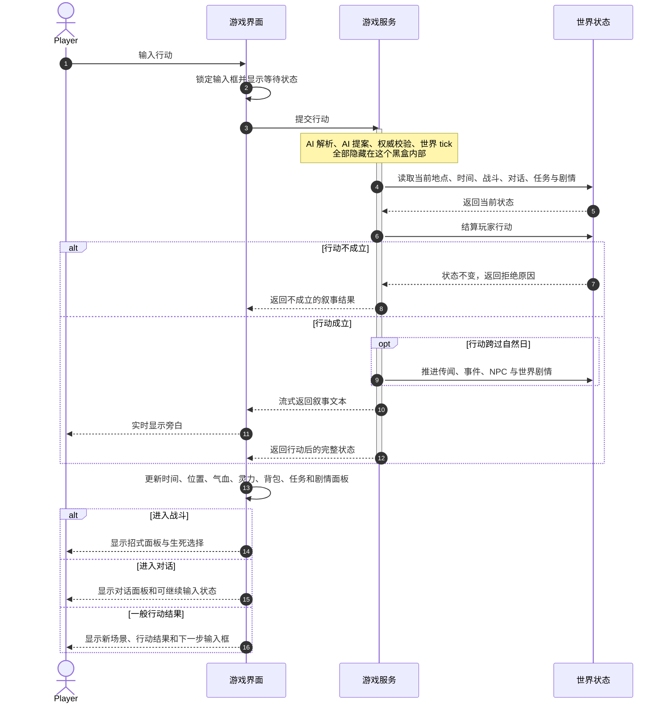

### 服务端行动处理时序图

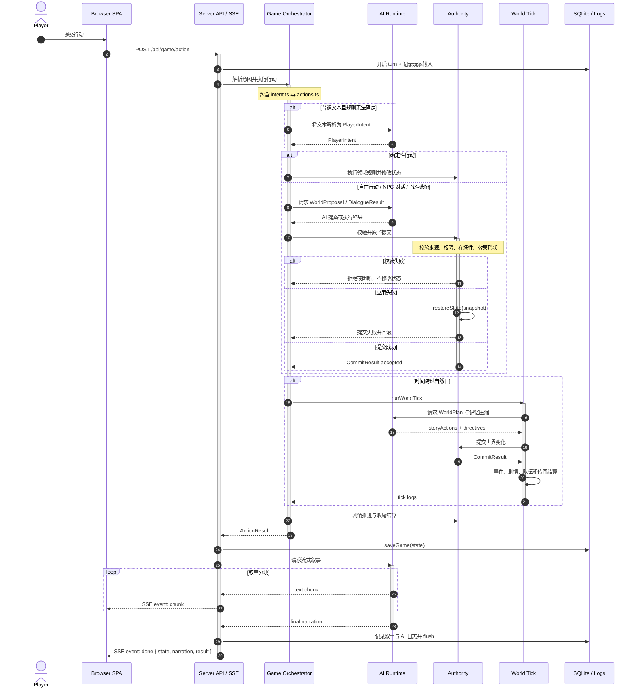

### 世界日推进时序图

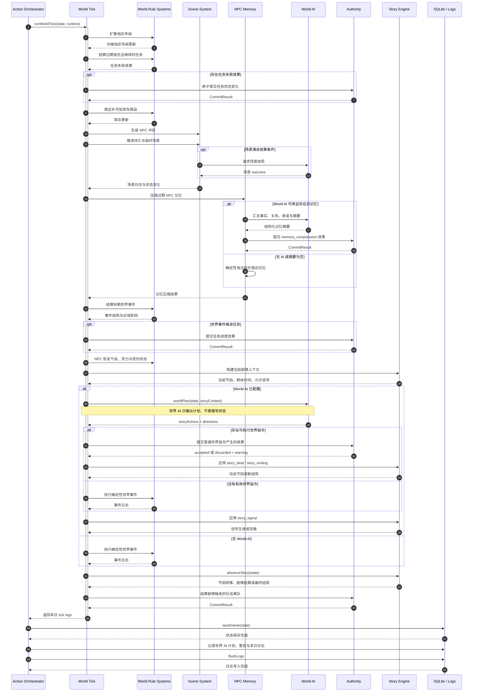

### ai提交与校验

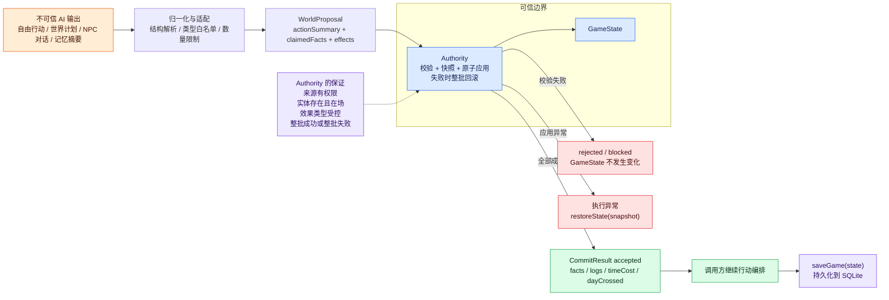

### 主线推进机制图

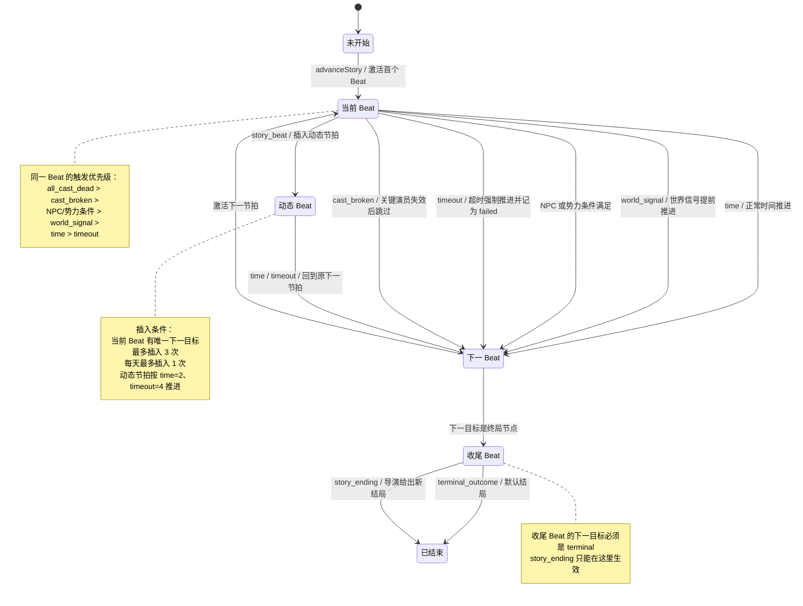

动态节拍是世界 AI 在主线运行过程中，为了回应玩家行为或世界变化，临时插入“当前节拍”和“原下一节拍”之间的一段主线剧情。

### 内置剧情主线图

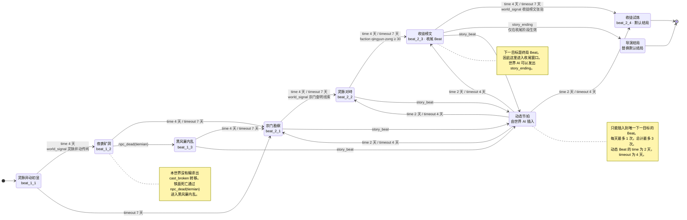

### NPC记忆生命周期图

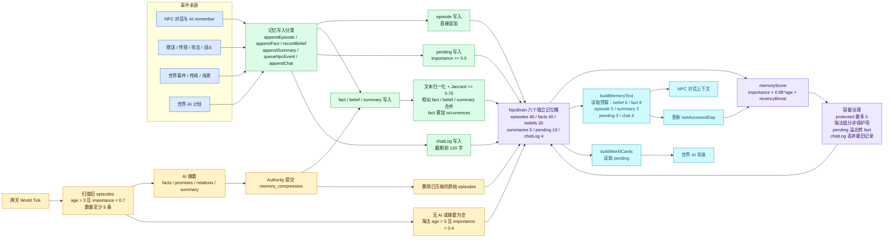
记忆桶约束

| 记忆桶 | 容量 | 读取预算 | 主要行为 |
|---|---:|---:|---|
| `episodes` | 40 | 5 | 按时间追加，不合并，是跨天压缩的主要对象 |
| `facts` | 40 | 8 | 相似内容合并，累计 `occurrences` |
| `beliefs` | 30 | 6 | 相似认知合并，记录 NPC 的主观判断 |
| `summaries` | 5 | 2 | 保存压缩后的长期摘要 |
| `pending` | 10 | 3 | 重要事件待处理队列，溢出时最旧一条降级为 `fact` |
| `chatLog` | 4 | 4 | 单条最多 120 字，只保留最近几句对话 |

## 反思与心得

### 需求规格

这次的需求输出还行, 主要是自己玩过很多游戏, 然后即时的借助了ai不断梳理知识点

### 设计与开发

但是在架构/模块设计上面还是有很多问题, 之前搞过一些, 由于ai不听话, 所以这次想的是用MVP快速验证, 避免效果还没出来, 自己就不行了

发现可能还是得自己先理解, 不然对项目的掌控力会越来越弱

### 验证与修复

最后是验证与修复环节, 中间试图使用aiProgram3 提到的循环验证, 即开启多个子代理扮演不同角色, 然后按照单线程的方式进行
提单=>问题审核=>开发修复=>修改审核=>关单的流程

但是发现还是不行, 还是需要人, 因为ai是一定会出错的,tmd, 就算只有0.0001%的概率, 它每个步骤累计起来, 那就很让人头疼了

关键是, ai出错, 你不知道它会错在哪里, 要是你自己写的话, 你可能会猜到自己在哪个模块随便搞了下, 出错概率比较大

ai就不行了, tmd, 很容易改完一个问题, 但是又改出新问题(你很难想到的位置), 或者把之前的问题又搞出来了, 防不胜防

> 另外提一嘴, gpt 5.6sol很喜欢搞tdd, 这个修复小问题还行, 在大问题上很容易迷失方向, 或者说注意力偏差

此外, ai容易出错, 或者说和你的预期不符, 它的原因可能是多样的, 不仅仅是因为现在的大模型是概率模型, 

还包含开发者思路不清晰, prompt传递有问题(语言歧义), ai理解有偏差, 开发者有独特于训练集的思路等等

所以, ai辅助开发, 是一定一定需要人参与的

### 优化

设计: 需要在ai的帮助下, 尽可能地猜想项目的边界, 架构设计需要清晰, 模块需要尽可能的保持扩展性, 高内聚低耦合
验证: 需要先完善需求规格, 模块接口合理, 然后设计测试方案, 对不同的功能模块进行业务专项测试
